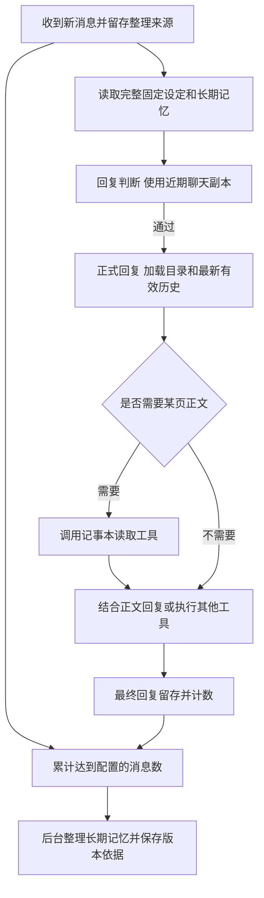

# 常驻记忆和记事本升级计划

将当前“所有记忆写进人格提示词”的方式，改为两种用途明确的内容：常驻记忆每轮加载，记事本只常驻目录、正文按需读取。后台定期整理常驻记忆，每次成功整理保存记忆全文和本次实际读取的原文来源；无变化的整理同样留存并提醒用户。

本计划作为实现与验收依据，覆盖上述分工、记事本渐进加载、记忆版本追溯，以及可配置的整理频率和记事本页数上限。工具契约、默认值、长度限制、管理入口和迁移步骤如下。

## 内容和修改权限

| 内容 | 保存什么 | 何时进入上下文 | 谁可以修改 |
| --- | --- | --- | --- |
| 固定设定 | 用户手写的核心人设和行为要求 | 每轮完整加载 | 用户手动修改 |
| 可整理的常驻内容 | 性格和人设、回复偏好、昵称三个分区 | 每轮完整加载 | 用户手动修改；后台定期整理任务更新 |
| 记事本目录 | 当前每一页的标识、名称和简短描述 | 正式回复每轮完整加载 | 随记事本页面的新增、修改、删除同步变化 |
| 记事本正文 | 黑话、成员关系、事实、事件、待办、约定、流程、SOP、使用经验等 | 机器人调用读取工具后加载 | 用户手动修改；机器人主动通过工具维护；后台整理可迁入旧黑话原文 |
| 记忆历史版本和整理原文 | 记忆全文、整理结果、本次读取的原文来源 | 用户打开管理页面时查询 | 系统追加保存 |

日常回复模型通过工具维护记事本。后台整理通过单独的保存路径更新三个常驻分区，也可迁移旧分区中的黑话原文；固定设定始终只读。

常驻内容回答“我是谁、如何称呼和交流”；记事本回答“有哪些具体事情需要知道、记住或照着做”。例如，机器人昵称可以属于常驻记忆，某位群友的旅行安排、某次故障的处理步骤应放在记事本。

## 模型可见内容

版本记录完全属于用户侧管理功能。插件为日常回复模型、回复判断模型和后台整理模型生成的系统提示、动态资料、工具定义、参数、返回值及错误消息，只包含当前任务所需的内容。版本编号、历史记录、恢复入口和版本机制说明保留在插件内部及用户管理页。当前记忆以正文形式加载，存储定位标记仅供内部读写使用。

后台整理模型接收当前固定设定、当前长期记忆、本批聊天原文和本次待读取的记事本页面原文，返回需要更新的分区正文。首次读取现有页面，后续读取新增或改动页面；成功保存记忆后确认读取进度，无变化同样确认，失败不推进。整理结果的留存、无变化判断和用户提醒由插件处理。

插件为管理功能使用单独的数据结构和接口，模型工具只能读取当前记忆、操作当前记事本页面。管理记录不作为新的聊天消息或模型资料注入。

记事本的使用条件和读写规则写在对应工具的描述中，随工具定义提供给正式回复模型。回复判断读取完整人设、记忆和近期聊天，不接收本轮记事本目录、工具描述和参数；历史中正常保留的工具记录仍受判断预算管理。

## 一轮对话怎样加载内容

a、每次请求从当前选中的人格读取固定设定和长期记忆，并生成当前记事本的完整目录。目录明确说明每页用途和读取方式，机器人据此决定是否读取、记录或修改页面。

b、目录作为本次请求的动态资料注入，不把同一份目录每轮追加到持久聊天历史。页面变动后的下一次请求会看到最新目录；本轮工具返回值让模型立即知道自己的操作结果。

c、回复判断和正式回复使用同一份常驻记忆，目录只提供给正式回复。判断裁剪独立的近期聊天副本，正式回复使用最新有效历史。判断模型不执行记事本工具，也不自动加载全部正文；某页正文只有实际读过、且仍在所用聊天窗口内时才可见。

d、记事本工具的调用和返回按 AstrBot 正常流程进入历史。已经读过的正文可以在后续轮次继续被利用，不强制每轮重读；需要确认当前内容时，主动重新读取。

页数上限限制的是当前目录规模。已经读取的正文仍可能随工具历史积累，其保留和压缩沿用 AstrBot 的聊天窗口机制，因此不能把“最多 100 页”等同于“整个对话上下文固定大小”。

## 记事本的使用规则

### 页面组织

每页保存稳定的 `page_id`、名称、简短描述和当前正文。名称和描述负责帮助模型找到正确页面，具体事实和操作步骤放在正文中。

建议由机器人按主题组织，例如“群成员饮食偏好”“表情包使用约定”“图片生成流程”。一页可以容纳多项相关事实，不要求一件小事占一页。涉及个人信息时，在正文标明对应成员和适用会话；不同人的偏好不能混成统一规则。

沿用现有人格的共享范围：同一人格使用同一份记事本，不按群另建一套。工具自动绑定本轮实际选中的人格，模型不通过参数切换到其他人格的记事本。

建议初始长度边界如下，后续可依据实际目录开销调整：

| 项目 | 建议边界 | 目的 |
| --- | --- | --- |
| 页面名称 | 最多 24 个字符 | 目录保持容易浏览 |
| 页面描述 | 最多 60 个字符 | 说明适用场景，避免把正文塞进描述 |
| 单页正文 | 最多 12,000 个字符 | 避免把全部内容集中进一页 |
| 单次读取正文 | 默认和最多 4,000 个字符，可分页继续读取 | 控制一次工具返回的大小 |
| 目录总量 | 默认最多 20,000 UTF-8 字节，可配置 | 同时约束多页名称、描述和结构开销 |

目录字节预算按实际注入的完整序列化内容计算，包含页面标识和结构开销。目录必须全量展示；新增页面或扩长目录信息导致超额时，返回明确错误，由机器人缩短描述或合并主题，不静默隐藏部分页面。将目录预算调到小于现有目录大小时，配置保存校验应报错并保留原有效值。

### 主动维护和容量用尽

工具说明提示机器人：遇到值得以后使用的事实、用户要求记住的事情、重复使用的流程或明确纠正，应检查目录，优先修改相关页面，再考虑新建。只说“记住了”不能视为保存成功，以写入工具成功返回为准。

页数上限计算当前未删除的页面，建议默认 100 页。达到上限后仍可读写已有页面；新建返回 `notebook_full`，机器人可以合并相关内容、删除明确失效的页面后再创建。系统不按创建时间或访问时间自动淘汰页面。

机器人和用户都可以删除页面。删除操作移除该页当前数据并释放页数，下一次目录反映删除结果。将页数上限调到小于现有页数时，保留所有页面，暂停新建，直至当前页数低于新上限。

页面更新覆盖当前内容。插件在当前处理任务内部记录模型实际读到的内容摘要和读取范围，写入或删除前在锁内核对当前数据；内容已被其他任务或用户修改时，提示重新读取后再操作。摘要及校验状态仅在插件内部使用，模型只提供页面标识和要修改的内容。

新建页面的容量检查与保存放在同一事务里，保证两个并发请求不会突破上限。同一处理任务内重复提交相同新建内容时，返回已经创建且内容相同的页面；该页已删除或改写后，按新的创建请求处理。

## 定期整理常驻记忆

### 频率和消息计数

频率按“累计多少条新消息”配置，建议默认 100 条，沿用已有计数口径：

- 一条用户消息算一条，没有触发回复的消息也计数。
- 一次模型最终回复算一条；工具调用、中间输出和流式片段不另计。
- 连续消息被回复判断插件合成一批时，仍按原始用户消息分别计数。
- 每个来源会话与人格组合分别累计，使用平台消息标识和本地去重标识防止重投重复计数。

所以 50 条用户消息加 50 次最终回复可以触发一次；机器人一直沉默时，100 条用户消息也可以触发。这里的 100 条不是 100 个用户与机器人的完整往返。

调低频率后，已有待整理消息达到新值即可进入处理；调高后保留计数继续累计。每次任务固定自己的消息范围和配置快照，中途改配置不改变已经开始的批次。重启、插件升级和切换当前聊天窗口不清空待整理队列。

关闭自动整理时沿用现有行为，暂停采集新消息和开始新整理任务，保留已有待处理消息、计数和追溯资料。重新开启后继续原有队列并采集后续消息；关闭期间未采集的消息不补算，也不标成已经整理。

### 什么可以改变

后台整理读取固定设定、当前常驻内容、本批新消息以及新增或改动的记事本页面，只在有明确依据时更新性格和人设、回复偏好、昵称。昵称标明适用会话和对象，黑话、成员关系、具体事实与流程保存在记事本。页面名称、描述与实际读取的正文快照随记忆来源保存，页面以后删除也不影响查证；内部读取进度只供插件使用。

临时玩笑、一时情绪、机器人自己的猜测或自述，不能直接作为长期设定的依据。事实、待办和 SOP 由日常回复模型通过记事本工具维护；后台常驻记忆整理不把这些内容重新堆回人格提示词。

建议为可整理的长期记忆单独设置 8,000 UTF-8 字节的默认上限。接近上限时允许去重、合并和表达精简，但仍有效的记忆不能为了塞入新内容而被静默删除。无法形成符合修改范围和预算的更新时，保留当前内容，记录失败原因。

### 整理和保存过程

a、在插件内部固定本次的当前记忆文本、来源会话、实际消息范围和待读取页面快照。模型输入包含固定设定、当前长期记忆与这些聊天和记事本原文。输入过长时分段处理，保存各次实际读取的原文与顺序，不通过跳过旧消息来宣称整批已整理。记事本不计入消息频率，仍按新聊天数触发。

b、模型返回需要更新的分区完整正文，例如 `{"updates": {"persona": "整理后的完整正文"}}`；无需更新时返回 `{"updates": {}}`。插件根据本次实际调用的数据关联原文来源，模型专注于记忆整理。

旧分区中的黑话通过可选 notebook_transfers 返回 section 和逐字原文 text。程序校验片段必须唯一存在于允许整理的分区；同次 updates 不能改写该分区。先保存记事本和待提交记录，再移出原分区；容量不足或保存失败时保留旧内容，成功确认后才推进聊天消息进度。

c、程序校验输出结构、允许修改的分区、固定设定完整性、预算及当前内容是否仍与任务开始时一致。插件以实际保存的正文比较结果确定“已更新”或“无变化”，不单凭模型自报结果。

d、先保存原文来源和待提交的记忆记录，内容需要更新时再通过 AstrBot 人格管理器写入并回读。确认成功后完成记录，并推进消息处理进度。插件数据库与 AstrBot 人格数据库不假定共用事务；使用内部待提交状态和内容摘要在重启后恢复，避免内容已改却丢失来源或重复应用。

e、整理期间用户或其他任务改变了同一人格时，不覆盖新内容。将本次任务记为冲突，保留这批消息，基于最新文本重新整理。失败和冲突与成功整理分开显示，不能当成“无变化”。

每次成功整理都保留一条可查看的记忆记录：有变化保存新正文，无变化保存相同正文并标记“无变化”，本次原文来源独立关联。存储层可以复用相同正文，用户侧仍能看到每次整理的结果和来源。

建议在用户管理页的整理记录和后台日志中提示“记忆整理完成：已更新”或“记忆整理完成：无变化”。提醒属于用户侧运行状态，不进入群消息、模型上下文或模型工具返回。

后台调用沿用来源会话的回复模型，不新增必须填写的 API Key。调用失败、超时、输出无效或版本冲突时，不推进这批消息的进度；重试沿用已有间隔保护，防止连续空转。

## 记忆版本和原文追溯

### 记忆记录保存什么

| 信息 | 用途 |
| --- | --- |
| 内部记录标识和时间 | 用户查看记忆记录及其顺序 |
| 记录来源 | 区分自动整理、用户编辑、恢复历史和升级迁移 |
| 完整固定设定和长期记忆快照 | 独立查看当时的全部常驻内容 |
| 整理结果 | 显示“已更新”或“无变化” |
| 本次实际读取的原文来源 | 展开这次整理看过的消息及其来源信息 |

内容快照和原文关联由插件保存，模型输入和输出只处理当前记忆正文。

### 原文来源

每一条自动整理记录关联该轮实际读过的原文。每条原文保留稳定标识、来源会话、角色、发送人标识、当时昵称、时间、文本和引用关系。分段整理时保留各次调用实际使用的原文范围和顺序。

整理使用的占位文本与原始记录分开保存，便于分辨模型实际看到了什么。管理页从某次整理打开对应来源列表，用户可以阅读全文自行核对记忆是否合理。

例如，本次整理后的记忆包含昵称“小比”，用户可以打开这次记录所关联的聊天原文核查；即使本次记忆没有变化，也能查看当次读过的消息。

媒体消息按当前采集能力保存文字和媒体引用，整理输入中的媒体占位符原样记录；没有识别图片时，不把它标成模型已经看过图片内容。

原文来源独立保存在插件数据中，不依赖当前聊天窗口，不在整理成功后清空。以后将聊天移出上下文，也仍可查看这些来源。记忆记录和原文来源默认保留，不按记事本页数上限清理；页数上限约束目录，不约束来源资料的磁盘用量。

### 手动修改和恢复

用户通过新管理页面编辑常驻内容时，保存完整内容，来源标记为用户编辑；没有聊天来源的手写内容如实显示“用户手动编辑”，不编造原文来源。

保留原 AstrBot 人格编辑入口。为覆盖该入口的正常保存，在插件生命周期内接入人格管理器的统一保存入口，识别内容变化并记录版本；自动整理和管理页面携带明确操作来源，避免重复记版本。热重载和卸载时恢复接入状态。实现时要验证原页面连续保存两次能留下两个版本，不能仅靠下一轮请求时轮询而遗漏中间版本。

直接改数据库等绕过保存入口的变动，只能在发现时记录当前快照并标注来源未识别，不能承诺恢复期间所有中间版本。

用户可以打开历史记忆全文和来源，并把选中的内容恢复为当前记忆，同时新增一条用户操作记录。恢复前展示选中的内容，固定设定是否恢复由用户在操作中明确选择；提交时的内容一致性校验由管理接口在内部完成。

## 配置项

常用配置放在插件配置页；字节预算作为高级配置，同时在管理页面显示当前实际占用。

| 配置 | 建议默认值 | 规则和作用 |
| --- | --- | --- |
| `auto_memory_enabled` | `true` | 控制消息采集和后台常驻记忆整理；关闭时保留已有消息、计数和追溯资料 |
| `auto_memory_message_interval` | `100` | 正整数，按新消息条数触发；对每个会话与人格组合分别生效 |
| `notebook_max_pages` | `100` | 正整数，每个人格当前可用页面数上限；降低时不删除已有页面 |
| `auto_memory_timeout` | `60` 秒 | 单次整理模型调用超时，沿用现有配置 |
| `long_term_memory_max_bytes` | `8000` | 可整理长期记忆的 UTF-8 字节上限；用户固定设定单独显示占用 |
| `notebook_catalog_max_bytes` | `20000` | 完整目录的 UTF-8 字节上限；包含名称、描述、页面标识和结构开销 |

整理频率和记事本页数上限由用户配置，模型工具不能修改这些配置。超时和目录预算等整数配置同样检查有效范围，非法值不静默解释成无限制。

固定设定、长期记忆和唯一判断提示词计入判断总预算，目录只提供给正式回复。管理页面分别显示两种常驻占用，判断剩余空间还需容纳协议与近期消息；预算低于必须保留的记忆时，显示数值与调整入口。判断裁剪只作用于副本，记忆与正式回复历史保持完整。

100 页、8,000 字节和 20,000 字节是不同约束。页数和字节预算同时满足才能新增或扩长相关内容；用户手写的固定设定过长，仍需要在总预算层面处理。

## 机器人工具契约

保留 `get_self_prompt` 的名称和只读用途，无模型入参，输出为 `ok`、`fixed_prompt` 和 `sections`。其中 `sections` 含当前 `persona`、`output_preferences` 与 `nicknames`；旧 `memory` 正文改由记事本读取。后台整理通过内部接口保存，日常写入工具操作记事本。

以下是拟定契约。所有工具绑定当前人格；参数不接受其他人格标识。失败统一返回 `ok: false`、稳定的 `error` 和便于处理的 `message`。写入成功才意味着数据已保存。

### `notebook_read`

| 参数 | 必填 | 默认值和含义 |
| --- | --- | --- |
| `page_id` | 是 | 要读取的当前页面标识 |
| `offset` | 否 | `0`，正文字符偏移 |
| `limit` | 否 | `4000`，本次读取字符数，范围为 1 到 4000 |

返回 `ok`、`page_id`、`title`、`description`、`content`、`offset`、`total_chars`、`next_offset` 和 `has_more`。插件在当前处理任务内记录读取状态；继续分页时发现内容变化，返回 `page_changed` 并提示从头读取，避免混合不同内容。当前页面已删除时返回 `page_not_found`。

### `notebook_create`

| 参数 | 必填 | 含义 |
| --- | --- | --- |
| `title` | 是 | 页面名称，非空，最多 24 个字符 |
| `description` | 是 | 页面用途和读取时机，非空，最多 60 个字符 |
| `content` | 是 | 完整正文，非空，最多 12,000 个字符 |

成功返回 `ok`、`page_id`、`title`、`description` 和 `remaining_pages`，不重复返回正文。容量不足返回 `notebook_full`；目录字节预算不足返回 `catalog_budget_exceeded`。

### `notebook_update`

| 参数 | 必填 | 含义 |
| --- | --- | --- |
| `page_id` | 是 | 要修改的页面 |
| `title` | 否 | 新名称；省略则保留 |
| `description` | 否 | 新描述；省略则保留 |
| `content` | 否 | 更新后的完整正文；省略则保留 |

三个内容字段至少提供一个，长度边界与创建一致。整体替换正文前，分段读完最新正文，合并保留仍有效内容；只改名称或描述时保留原正文。保存层用本任务的读取状态校验当前内容，首次编辑需先读取，冲突时提示重新读取。成功后覆盖当前数据，返回 `ok`、`page_id`、`title` 和 `description`。

### `notebook_delete`

| 参数 | 必填 | 含义 |
| --- | --- | --- |
| `page_id` | 是 | 要删除的页面 |

删除前先读取页面，由插件在内部核对当前内容。成功返回 `ok`、`page_id`、`page_count` 和 `remaining_pages`；该页当前数据被移除，目录同步减少一项。

工具调用及返回继续进入正常聊天历史。已读过的页面正文可以留在正常聊天窗口中，当前记事本操作以页面现状为准。

## 用户管理入口

在 AstrBot 插件页面能力内提供“记忆与记事本”管理页，复用现有登录认证和插件 API，不另起公开管理服务。日常查看和编辑集中在三个区域：

| 区域 | 用户能做什么 |
| --- | --- |
| 当前记忆 | 查看和编辑固定设定、性格和人设、回复偏好、昵称；查看字节占用和下次整理进度 |
| 记事本 | 查看完整目录、剩余页数，打开正文，创建、编辑和删除当前页面 |
| 记忆版本与整理记录 | 打开记忆全文和本次原文来源，查看“已更新”“无变化”及失败、冲突记录，恢复选中的记忆内容 |

记忆记录列表显示时间、来源和“已更新”或“无变化”；详情展示当次记忆全文和关联的原文列表。每次成功整理在用户管理页留下结果提醒，后台日志同时记录简短状态。失败任务显示实际失败原因，完整聊天内容不写进控制台日志。时间保存为 UTC，展示遵循 AstrBot 配置的时区。

原人格页面继续可用；记事本的独立存储有对应查看和手动编辑入口，不成为只有模型能访问的数据。

## 旧数据迁移

a、先备份当前人格原文、已有备份、配置和消息队列，再创建新的存储结构和迁移记录。重复启动按迁移标识检查，保证不重复创建页面或版本。

b、现有固定区逐字保留；原 `persona` 和 `output_preferences` 作为可整理长期记忆的初始内容。旧 `memory` 完整移入“迁移记忆”页面；超出单页边界时按原文顺序拆页，保留顺序和内容摘要。首次迁移不依赖模型重新总结，避免凭空丢内容。

新增 nicknames 分区初始为空，旧人设中的昵称先保留，到正常的下一次整理时按含义归类。混在旧分区中的黑话同样在后续整理时识别，通过上述逐字迁移流程保存到记事本。

c、只有页面写入并回读确认后，才从常驻提示词中移出原 `memory` 正文。迁移后的目录立即指向这些页面。页面数或目录预算容纳不下迁移内容时，不截断原文、不改常驻提示词，管理页提示需要先调整配置或手工整理。

d、将迁移前后内容保存为基线记录。现有纯文本备份保留并可导入查看，但缺失的原文关联不伪造；文件时间不能直接冒充真实修改时间，历史顺序无法确定时如实标注。

e、现有未完成整理队列继续处理，不丢消息、不重算已完成批次。新版开启后的来源记录按新规则保存；旧版已清空的队列正文不能被宣称已恢复。

f、复用原 `auto_memory_enabled` 和超时配置，新增频率和页数上限仅在未配置时使用建议默认值。固定设定或初始长期记忆超过新预算时，完整保留，禁止通过自动删减完成升级。

g、旧插件工具记录若含管理用的版本字段，在组装模型输入的副本中移除这些字段；受影响的原始工具消息先独立保存在插件数据库。即使 AstrBot 后续持久化这份模型输入，原始消息也可保留。处理限定于本插件生成的管理字段，维持工具调用关系和业务正文。

## 开发顺序和验收

| 阶段 | 交付内容 | 完成依据 |
| --- | --- | --- |
| 存储和迁移 | 当前页面、原文来源、任务和记忆记录；可恢复的记忆提交流程 | 用真实旧版数据的私有副本验证迁移前后原文一致，重复迁移不新增重复内容 |
| 工具和上下文 | 只读常驻记忆、记事本四个工具、每轮目录、回复判断衔接 | 捕获 AstrBot 实际组装请求，确认目录完整、未读正文缺席、正式回复窗口未被缩短 |
| 自动整理和追溯 | 可配置计数、后台更新、原文关联、用户结果提醒和冲突恢复 | 运行实际任务路径，检查边界计数、来源关联、无变化记录与提醒及失败不推进进度 |
| 管理页面 | 手动编辑、记忆全文和原文、当前页面管理、记忆恢复 | 在隔离测试实例中实际操作并回读；原人格页面连续编辑也能形成独立记忆记录 |
| 真实模型验证 | 按目录读页、主动记事、明确纠正人设和依据质量 | 使用获准的真实模型调用观察行为；将模型表现与程序校验结果分别记录 |
| 打包发布 | 插件包、升级说明、原插件源的一键更新 | 检查发布包、版本、下载地址和校验值一致；用隔离旧版实例完成安装升级 |

关键验收场景：

- 未达到配置数量时不整理，达到后处理准确的一批；沉默消息、批量回复和消息重投的计数正确。
- 自动整理只能改可整理长期记忆；固定区和日常工具权限不能被绕过。
- 每次成功整理都能看到当次记忆全文和真实读取的原文；无变化时来源同样保存，并向用户提示“无变化”。
- 两个并发任务、用户编辑或故障重启不会导致覆盖新版本、丢失依据或重复应用。
- 目录每轮全量可见；正文通过工具按需进入；工具历史按原机制保留。
- 剩一页容量时并发创建，只有一个成功；满页、目录预算超额、降低页数、更新和删除均符合前文规则。
- 记事本工具不能更改常驻记忆；管理页面手动编辑、原页面编辑和恢复历史都形成可辨认来源的版本。
- 将聊天移出当前上下文后，版本原文仍能展开；UTC 保存和配置时区展示一致。
- 旧 memory 分区完整迁移；混在人设中的黑话由后续整理识别，先逐字保存到记事本再移出，固定设定和其余原文保留；旧版本缺失的依据明确显示缺失。
- 检查日常回复、回复判断及后台整理的实际请求，确认插件生成的上下文、工具定义和工具返回不包含版本编号、版本操作、版本机制说明或存储定位标记。
- 真实模型遇到明确昵称约定时形成带依据的新版本，遇到临时玩笑、引用或机器人自述时不误记为明确约定。
- 真实模型面对事实、待办或 SOP 时维护对应记事本页面；后续相关任务能通过目录找到页面并读取需要的正文。

存储、并发、迁移和请求组装可以先运行真实代码做确定性验证。机器人是否会恰当读页、主动写页，以及整理是否误解原文，需要真实模型验证，不能用模拟响应宣布这些行为已经通过。验证在隔离实例进行，真实调用的模型、费用和数据范围先按已有授权核对，不发送 QQ 群消息。

## 发布方式

后续实现沿用 `astrbot_plugin_self_prompt` 仓库，作为现有插件升级交付。使用 git 和 gh 发布，继续接入 `astrbot_plugin_reply_gate` 仓库中的同一个 `plugins.json` 插件源，并更新对应版本和校验文件。插件更新保留私有数据，版本原文与聊天资料不进入 GitHub 发布包。
